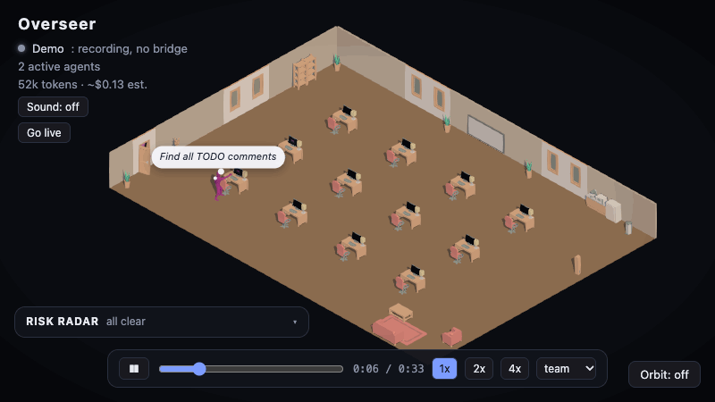
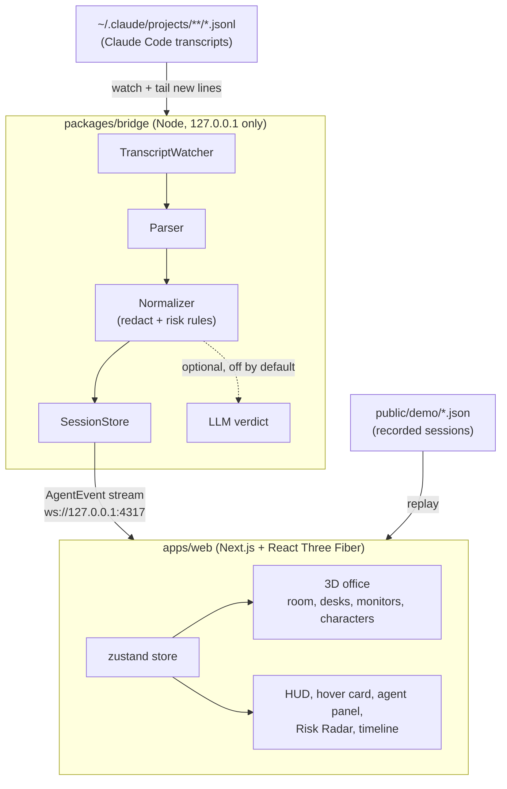

# Overseer

**A 3D office for watching your AI coding agents work.**

Overseer turns live Claude Code sessions into little animated people in a low poly office. Each
agent walks in through the door, sits at a desk, types, reads, runs commands and reacts to what it
is really doing. Subagents get their own desk next to their parent. Hover a character to see its
current action; click it to follow it with the camera and open its timeline. The **Risk Radar**
lights up a desk when an agent runs something risky (shell commands, secret files, network calls)
and gives a short safety verdict.



**Try the demo:** https://agent-overseer.vercel.app/ (a recorded session). To watch your own
agents there, run `npx overseer-bridge` (or `pnpm dev:bridge` from this repo)
and click **Go live**; Chrome may ask to allow local network access.

Everything runs on your machine. Transcripts are read locally and never leave it (see
[Privacy](#privacy)).

## Quick start

**Fastest:** run `npx overseer-bridge`, open https://agent-overseer.vercel.app/ and click
**Go live** (allow local network access if Chrome asks). No clone needed.

**From source:**

Needs Node 20+, [pnpm](https://pnpm.io) and Google Chrome, Safari or Firefox with WebGL 2.

```bash
pnpm install
```

```bash
pnpm dev
```

Open http://localhost:3000. Every Claude Code session you have used in the last 30 minutes shows up
as a character, and new ones walk in as you start them. No session running? The page plays a
recorded demo until the bridge sees one.

Just want to look around? Run `pnpm dev:web` alone and open http://localhost:3000/?demo=team.

### Using it

- **Hover** a character: name, current action, how long it has been at it.
- **Click** a character: the camera follows it and the side panel shows its timeline, files
  touched and risk events. `Esc` lets go.
- **HUD** (top left): live or demo, active agents, tokens and estimated cost, sound on/off (muted
  by default), "Go live" / "Watch demo".
- **Timeline** (bottom, demo mode): play/pause, scrub, 1x/2x/4x, pick a demo.
- **Risk Radar** (bottom left): every medium and high risk call, newest first.

### URL options

| Option              | Effect                                                                  |
| ------------------- | ----------------------------------------------------------------------- |
| `?demo=team`        | Play a recorded demo (`team`, `risk` or `sample`) and ignore the bridge |
| `?live`             | Live only: never fall back to a demo                                    |
| `?demo`             | Office with fake agents from the Debug panel only (development)         |
| `?fx=0` / `1` / `2` | Force effects off / bloom / bloom + anti-aliasing + vignette            |
| `?time=0.5`         | Fix the day/night cycle (0 morning, 0.5 evening, 1 night)               |
| `?zoom=1.5`         | Camera zoom multiplier                                                  |

## How it works



- **`packages/bridge`** watches Claude Code's transcript files, reads only the new lines, turns them
  into small typed events (`tool_start`, `thinking`, `waiting_for_user`, `subagent_spawn`, ...) and
  serves them over a local WebSocket. Unknown lines are skipped, never fatal.
- **`packages/shared`** holds the zod event schema and the agent state machine both sides use.
- **`apps/web`** validates every message, maps each agent's state to an animation (walk, sit, type,
  read, run commands, think, raise a hand when waiting, cheer, slump) and draws the office. Monitors show what each agent
  is working on; thought bubbles show what it is thinking about.

More detail: [docs/ARCHITECTURE.md](docs/ARCHITECTURE.md).

## Risk Radar

Every tool call gets an offline risk level from simple rules:

- **High:** reading or writing secret files (`.env`, keys, credentials), `rm -rf`, piping a
  download into a shell, `chmod 777`, `sudo`, force pushes, writes to shell or system config.
- **Medium:** network commands, fetching unknown sites, package installs, `npx`-style runners,
  git pushes, deleting files, searching for secret files.
- **Low:** other shell commands and writes outside the project.
- **None:** reads, edits and searches inside the project.

High risk makes the desk lamp glow red and pulses the room light; medium glows orange. The panel
lists the reasons.

Optional: set `OVERSEER_LLM=1` (and `ANTHROPIC_API_KEY`) to add a one-line verdict from Claude Haiku
5.5 for medium and high risk calls. It only ever sees the redacted one-line summary, results are
cached, it times out after 3 s, and it can never lower the rule level.

## Privacy

- The bridge listens on **127.0.0.1 only**. Nothing is sent to the internet by default.
- Transcripts are read locally. Only short summaries leave the bridge, and only to the page on your
  machine: tool names, relative file paths, one-line commands, short message snippets.
- Every summary is **redacted** first: API keys and tokens, `NAME=value` secrets, emails, long
  random strings and your home folder path are masked.
- The optional LLM verdict (off by default) sends only that redacted one-line summary to the
  Anthropic API.
- Demo files are recorded the same way, so they contain only redacted summaries. Review them before
  sharing.

## Recording demos

Turn any Claude Code session into a demo file the page can replay:

```bash
pnpm record <sessionId> --name my-demo --title "Fix the login bug"
```

This writes `apps/web/public/demo/my-demo.json` (open it with `?demo=my-demo`). The session id is
the transcript file name under `~/.claude/projects/<project>/`.

`scripts/record-demos.sh` re-records the bundled `team` and `risk` demos with headless Claude Code
in a throwaway copy of `scripts/demo-app`. It needs a logged-in `claude` CLI and uses normal Claude
usage.

## Commands

| Command                                | What it does                                  |
| -------------------------------------- | --------------------------------------------- |
| `pnpm dev`                             | Bridge and web together                       |
| `pnpm dev:web`                         | Web only (demo replay when no bridge runs)    |
| `pnpm dev:bridge`                      | Bridge only; add `--log` to print every event |
| `pnpm test`                            | Vitest across all packages                    |
| `pnpm typecheck`                       | TypeScript, strict                            |
| `pnpm lint`                            | ESLint                                        |
| `pnpm record`                          | Turn a session into a demo file               |
| `node scripts/gif.mjs <url> <out.gif>` | Record a GIF of the page with headless Chrome |

Bridge settings: `--port` / `OVERSEER_WS_PORT` (default 4317), `--dir` / `OVERSEER_CLAUDE_DIR`
(default `~/.claude/projects`), `OVERSEER_LLM=1`, `OVERSEER_LLM_MODEL`.

## Performance

Built to hold 60 fps with 12 agents on a mid range laptop: instanced furniture, one shared
character model, monitor textures redrawn at most 4 times a second, no dynamic lights for risk
effects, and effects that step down automatically on slow GPUs. Measured: 57 to 60 fps, 117 draw
calls with 12 agents and full effects; all 3D models together are 1.2 MB.

## Credits

- Furniture: [Kenney Furniture Kit](https://kenney.nl/assets/furniture-kit), CC0.
- Character: [Quaternius Animated Human](https://quaternius.com), CC0.
- Details in [apps/web/public/models/CREDITS.md](apps/web/public/models/CREDITS.md).
- Built with Next.js, React Three Fiber, drei, postprocessing, zustand, chokidar, ws and zod.

## License

[MIT](LICENSE). The 3D models are CC0 (see Credits).
